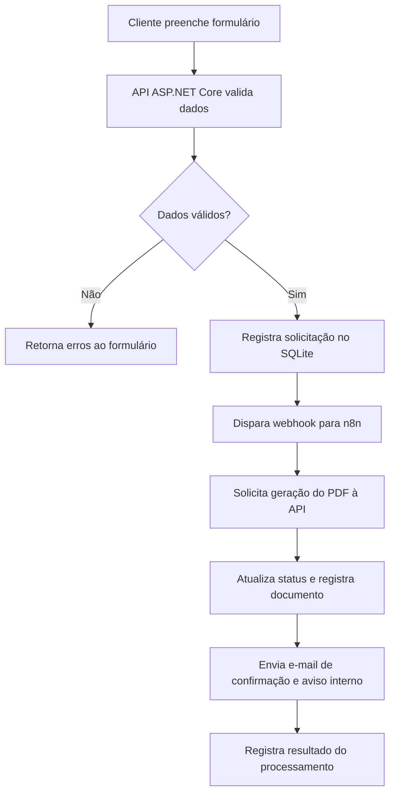

# Projeto 02 — FluxoPro | Automação de Orçamentos

> **Status:** MVP local e fluxo n8n/SMTP testados com dados fictícios em 04/11/2026. Evolução 2.0 implementada localmente e aguardando revisão do novo workflow · **Tipo:** projeto autoral demonstrativo para portfólio.

## 1. Visão geral

O **FluxoPro** é uma solução demonstrativa de automação do processo de solicitação de orçamentos para pequenas empresas e prestadores de serviços. O cliente preenche um formulário, a aplicação valida os dados, registra a solicitação, gera um PDF com o orçamento e aciona notificações por e-mail por meio de um fluxo no **n8n**.

**Objetivo do portfólio:** demonstrar desenvolvimento backend com C#/.NET, integração por APIs e webhooks, orquestração de processos e tratamento de falhas. O projeto **não representa um sistema já entregue a um cliente**.

## 2. Problema e proposta de valor

Solicitações recebidas por diferentes canais podem exigir digitação manual, criação repetitiva de documentos e acompanhamento por e-mail. O FluxoPro demonstra como centralizar essas etapas e reduzir tarefas repetitivas.

**Fluxo principal:**



> A implementação atual trata falhas de rede, reenvios controlados e indisponibilidade do serviço de e-mail. Consulte o [README](README.md) para o estado verificado.

## 3. Público-alvo

- Pequenas empresas que recebem pedidos de orçamento pelo site.
- Prestadores de serviços que precisam padronizar propostas.
- Equipes administrativas com tarefas manuais de registro e notificação.

## 4. Escopo do MVP

### 4.1 Formulário público

- Campos: nome, e-mail, telefone opcional, tipo de serviço, descrição e quantidade/escopo.
- Validação no navegador **e no servidor**.
- Feedback de envio e mensagens de erro compreensíveis.
- Consentimento e aviso de privacidade compatíveis com o uso demonstrativo.

### 4.2 API ASP.NET Core

- Endpoint para criar solicitações.
- Validação de campos e normalização de entradas.
- Geração de identificador único para cada solicitação.
- Persistência em SQLite com status do processamento.
- Endpoint interno autenticado para geração/consulta de PDF, se necessário ao fluxo.
- Registro estruturado de erros e eventos relevantes.

### 4.3 Automação no n8n

- Recebimento de evento via webhook.
- Consulta ou atualização da solicitação na API.
- Acionamento da geração de PDF.
- Envio de notificação para a empresa e confirmação ao solicitante.
- Registro de sucesso/falha, com estratégia de repetição controlada.

### 4.4 Orçamento em PDF

- Identificador, data, dados do solicitante e descrição dos serviços.
- Valores de exemplo configuráveis e total calculado pela aplicação.
- Layout simples, profissional e legível.
- Aviso **“Documento demonstrativo — sem validade comercial”** nos exemplos públicos.

### 4.5 Acompanhamento

- Consulta de solicitações e status (`Recebida`, `Em processamento`, `Concluída`, `Falha`).
- Para o MVP, a consulta pode ser feita por endpoint protegido ou interface administrativa mínima.

## 5. Tecnologias previstas

| Tecnologia | Finalidade |
|---|---|
| **ASP.NET Core (C#)** | API, validação, regras de negócio e geração de PDF |
| **n8n** | Orquestração do workflow e integrações |
| **Webhooks e REST** | Comunicação entre formulário, API e automação |
| **HTML5, CSS3 e JavaScript** | Formulário responsivo |
| **SQLite** | Armazenamento local de solicitações e status |
| **SMTP / serviço de e-mail** | Notificações transacionais |
| **Git e GitHub** | Versionamento, documentação e apresentação |

**Observação:** essas tecnologias já estão em uso no projeto. O PDF é gerado com QuestPDF.

## 6. Arquitetura proposta

```text
fluxopro/
├── src/
│   ├── FluxoPro.Api/              # Endpoints, autenticação e configuração
│   ├── FluxoPro.Application/      # Casos de uso e validações
│   ├── FluxoPro.Domain/           # Entidades e regras de negócio
│   ├── FluxoPro.Infrastructure/   # SQLite, PDF, integrações e logs
│   └── FluxoPro.Web/              # Formulário web (ou frontend estático)
├── automation/
│   └── fluxopro-workflow.json     # Export do n8n sem credenciais
├── tests/
│   └── FluxoPro.Tests/
├── docs/
│   ├── architecture.md
│   ├── api.md
│   └── screenshots/
├── .env.example
├── .gitignore
└── README.md
```

A separação em projetos .NET é opcional para o MVP: se aumentar o custo de manutenção, pode-se começar com uma API modular e evoluir conforme necessário.

## 7. Modelo de dados inicial

**SolicitacaoOrcamento**

| Campo | Descrição |
|---|---|
| Id | Identificador único |
| Nome | Nome do solicitante |
| Email | E-mail de contato |
| Telefone | Opcional |
| Servico | Tipo de serviço solicitado |
| Descricao | Detalhes informados |
| ValorEstimado | Valor calculado para fins demonstrativos |
| Status | Estado do processamento |
| CriadoEm | Data/hora de criação |
| AtualizadoEm | Última atualização |
| ChaveIdempotencia | Evita processar o mesmo envio repetidamente |

Não armazenar senhas, credenciais de SMTP ou tokens do n8n nessa tabela.

## 8. Contrato inicial da API (proposta)

| Método | Rota | Finalidade |
|---|---|---|
| `POST` | `/api/solicitacoes` | Receber e validar nova solicitação |
| `GET` | `/api/solicitacoes/{id}` | Consultar solicitação (acesso protegido) |
| `POST` | `/api/solicitacoes/{id}/gerar-pdf` | Gerar PDF (acesso interno protegido) |
| `PATCH` | `/api/solicitacoes/{id}/status` | Atualizar status (acesso interno protegido) |
| `GET` | `/health` | Verificação básica de saúde da API |

A definição definitiva dos endpoints e da autenticação será fechada na implementação.

## 9. Requisitos de segurança e confiabilidade

- Nunca publicar credenciais, tokens ou dados reais de clientes no GitHub.
- Proteger endpoints internos e webhooks com autenticação/segredos.
- Validar todos os dados no backend; limitar tamanho das entradas e frequência de requisições.
- Aplicar idempotência para evitar PDFs e e-mails duplicados.
- Tratar falhas no envio de e-mail sem perder a solicitação registrada.
- Evitar incluir dados pessoais nos logs; usar dados fictícios na demonstração.
- Configurar CORS apenas para as origens necessárias.
- Documentar retenção e exclusão de dados do formulário, considerando a LGPD.

## 10. Etapas de desenvolvimento

### Semana 1 — Fundação
- Criar repositório, solução .NET e estrutura básica.
- Definir campos, regras e estados da solicitação.
- Criar API de cadastro e persistência SQLite.

### Semana 2 — Interface e PDF
- Implementar formulário responsivo e validações.
- Criar serviço de geração de PDF e modelo visual.
- Testar criação e consulta de solicitações.

### Semana 3 — Integração n8n
- Configurar n8n em ambiente de desenvolvimento.
- Criar webhook e fluxo de orquestração.
- Integrar geração de PDF e notificações.

### Semana 4 — Robustez e apresentação
- Adicionar tratamento de erros, idempotência e testes.
- Criar screenshots, diagrama e vídeo curto de demonstração.
- Escrever README de apresentação e instruções de execução.

### Semanas 5–6 — Reserva
- Corrigir problemas, refinar interface e preparar hospedagem/demo se viável.

## 11. Critérios de aceite do MVP

- [x] Formulário cria uma solicitação válida.
- [x] Entradas inválidas recebem mensagens claras.
- [x] Solicitação é registrada com identificador e status.
- [x] Workflow do n8n é acionado com segurança.
- [x] PDF demonstrativo é gerado com dados corretos.
- [x] As duas notificações foram recebidas na caixa de entrada; o PDF chegou anexado à confirmação.
- [x] Reenvio da mesma solicitação não produz processamento duplicado na API.
- [x] Falhas são registradas e podem ser diagnosticadas na API.
- [x] Nenhum segredo está presente no repositório.
- [x] README explica instalação, arquitetura e limitações.

## 12. Demonstração e publicação no portfólio

**Materiais a preparar após a implementação:**

1. Screenshot do formulário.
2. Screenshot do workflow n8n, sem credenciais.
3. Exemplo de PDF com dados fictícios.
4. Screenshot da listagem de solicitações/status.
5. Diagrama de arquitetura e instruções de execução.
6. Link para demonstração online, **somente se estiver realmente disponível**.

**Título sugerido (até 50 caracteres):** `FluxoPro | Automação de Orçamentos`

**Descrição para portfólio (rascunho; publicar somente após concluir):**

> Automação demonstrativa de solicitações de orçamento com formulário web, API em ASP.NET Core e fluxo n8n. A solução valida e registra pedidos, gera PDFs e envia notificações automaticamente. Integração via REST e webhooks, com tratamento de falhas e prevenção de duplicidade. Tecnologias: C#, .NET, n8n, JavaScript e SQLite.

## 13. Fora do escopo inicial

- Pagamentos e assinatura eletrônica.
- CRM completo, multiempresa ou controle de permissões complexo.
- Integração oficial com WhatsApp.
- Cálculo avançado de preços e regras tributárias.
- Operação comercial real com dados de clientes.

## 14. Evolução 2.0 e próximos passos

A versão local acrescenta painel administrativo com indicadores, busca e filtros, histórico de status, serviços e preços configuráveis, templates de e-mail, exportação CSV, autenticação, testes e CI. A API foi separada em `Endpoints`, `Services`, `Models` e `Infrastructure`. A reserva atômica dos pedidos e as transições de estado são verificadas no SQLite.

1. Revisar o painel e as alterações locais antes de publicar no repositório.
2. Importar o workflow atualizado no n8n e configurar as credenciais do novo nó `Consultar mensagens`.
3. Testar novamente o formulário e os dois e-mails com o novo workflow.
4. Preparar capturas de tela com dados fictícios e publicar o material do portfólio.

---

**Nota de implementação:** consulte o README para executar a aplicação. O fluxo anterior completou o teste local; o novo export do n8n ainda precisa de teste ponta a ponta após a importação.
