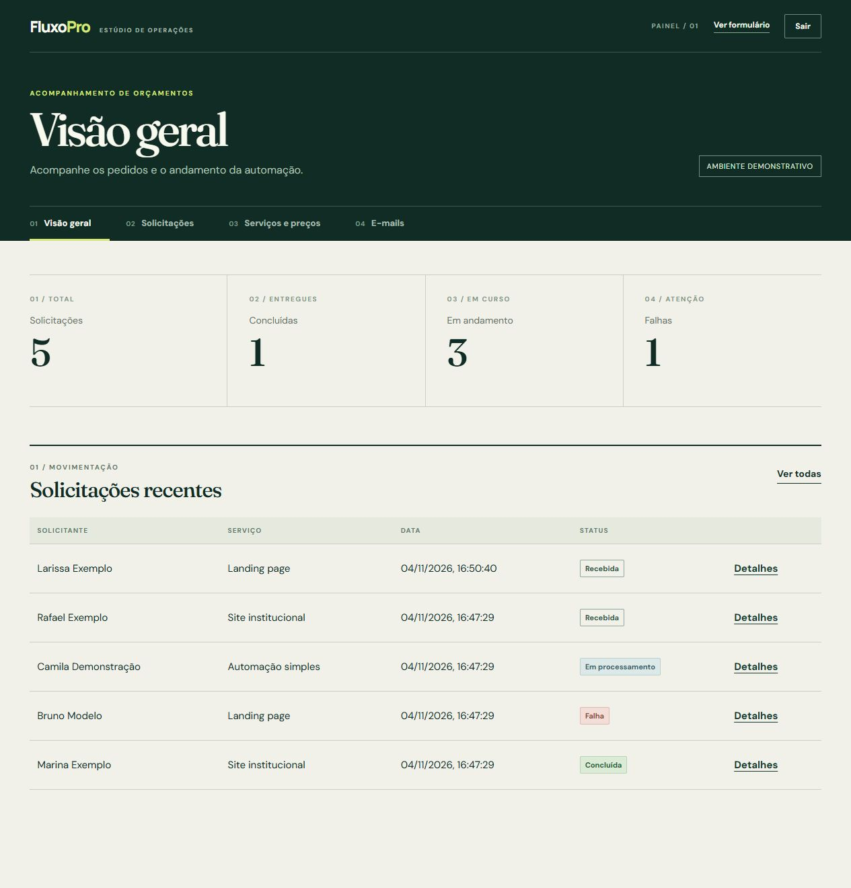
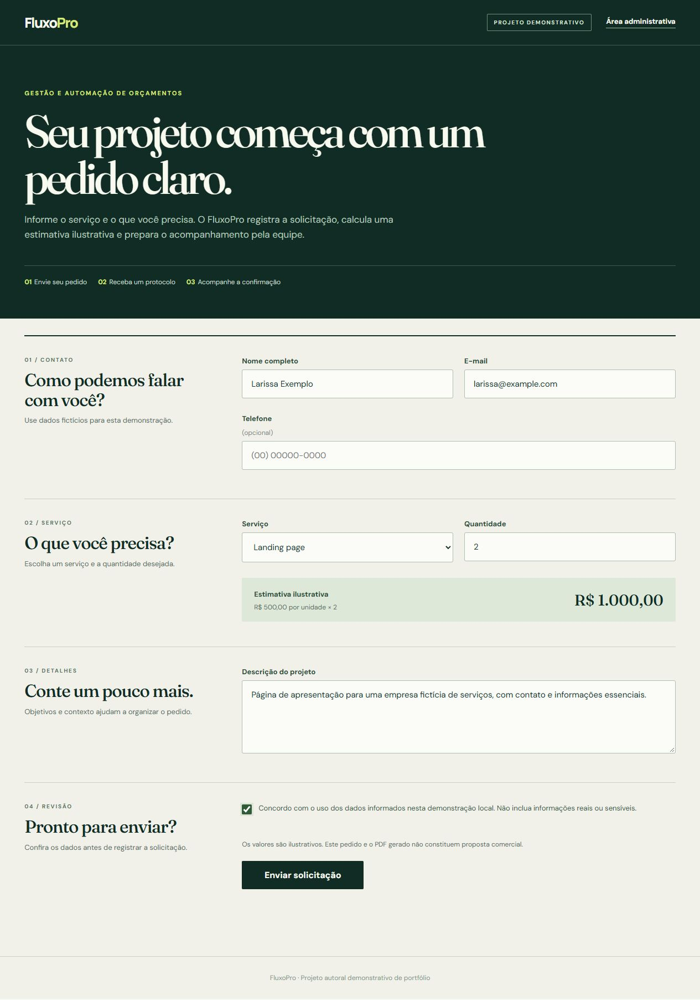
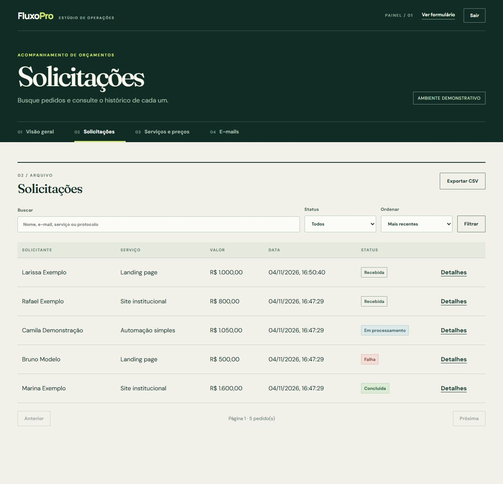
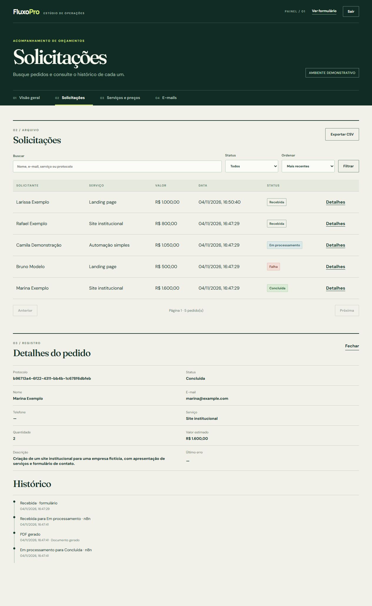
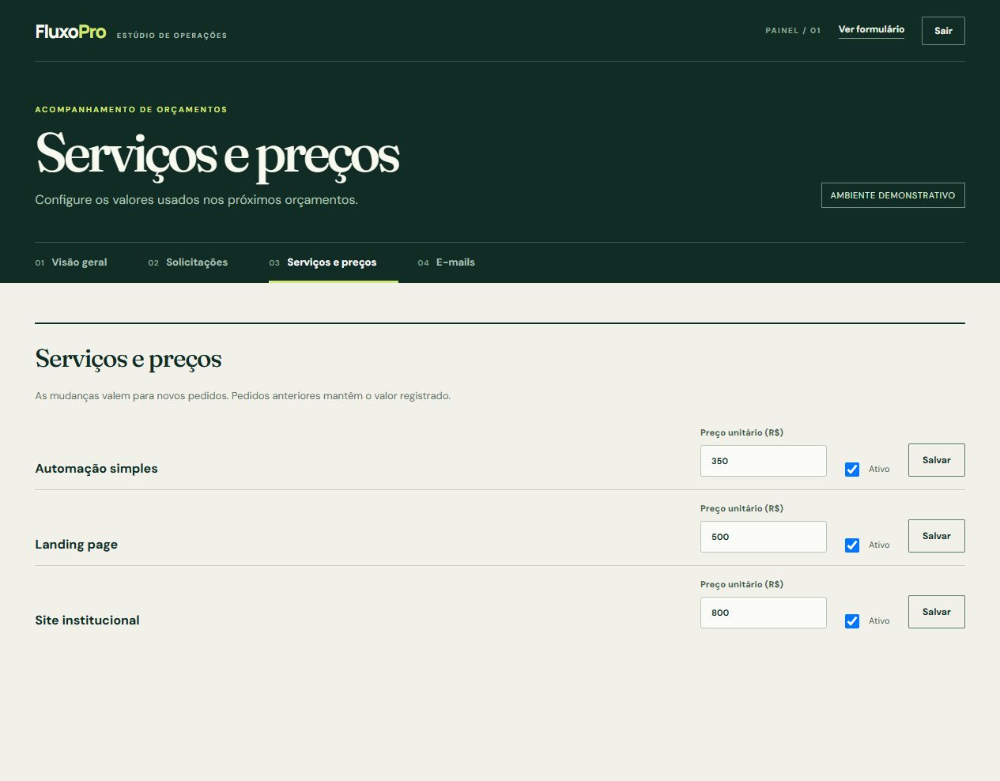
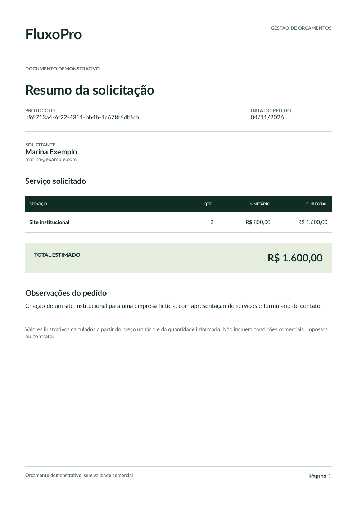
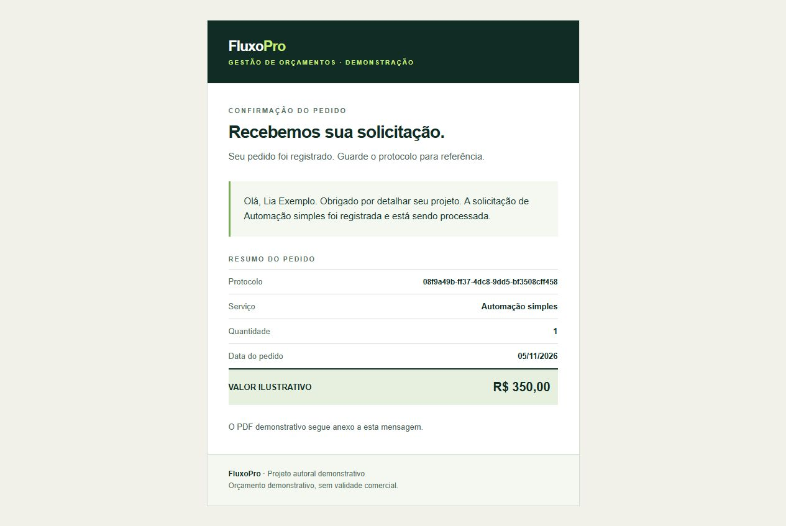

# FluxoPro — Gestão e Automação de Orçamentos

**Um lugar para receber pedidos, preparar orçamentos e acompanhar cada etapa.**

O FluxoPro reúne o formulário de solicitação, o documento em PDF, as notificações por e-mail e o acompanhamento da equipe em um só fluxo. É um projeto autoral demonstrativo de portfólio, desenvolvido com dados fictícios.

*No painel, a equipe vê os pedidos recentes e o andamento de cada solicitação.*

## Como funciona

1. A pessoa descreve o projeto, escolhe o serviço e recebe um protocolo.
2. O sistema registra o pedido, prepara o PDF e aciona a automação de e-mail configurada.
3. A equipe acompanha o status e o histórico no painel, encontra pedidos por busca e ajusta serviços e preços.

## Conheça as telas

### Um pedido claro desde o início

O formulário apresenta os serviços, calcula uma estimativa ilustrativa e orienta o preenchimento.

Após o envio, a pessoa recebe um protocolo para identificar a solicitação.

### Acompanhamento sem perder o contexto

A equipe pode buscar, filtrar e ordenar os pedidos. Em cada detalhe, consulta as informações e o histórico de alterações.

### Serviços e valores ajustáveis

Os preços podem ser editados no painel para novos pedidos, preservando o valor registrado nos anteriores.

### Documento e comunicação no mesmo fluxo

O PDF apresenta serviço, quantidade e valor ilustrativo. A confirmação por e-mail tem versões HTML e texto, com o documento anexado quando a automação está configurada.

Veja também o [PDF demonstrativo completo](docs/exemplo-orcamento.pdf).

## Sobre o projeto

O FluxoPro é uma demonstração autoral para apresentar uma solução de gestão e automação de orçamentos. As capturas mostram a aplicação em funcionamento com dados fictícios; não representam clientes ou resultados comerciais.

**Tecnologias:** ASP.NET Core (.NET 10), SQLite, QuestPDF, JavaScript, n8n e Docker.

### Para explorar a implementação

- [Instalação, configuração local e testes](docs/instalacao.md)
- [Arquitetura e integração com n8n](docs/architecture.md)
- [Referência da API](docs/api.md)
- [Segurança e limites da demonstração](docs/seguranca.md)

**Autor:** [caiussord](https://github.com/caiussord)
