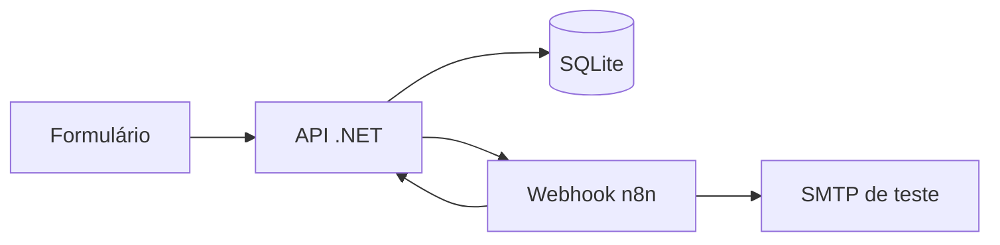

# Arquitetura

A API grava o pedido antes de tentar entregá-lo ao n8n. O dispatcher consulta pedidos pendentes, envia apenas ID e ID do evento e registra tentativas. O n8n reserva o pedido com `POST /iniciar`, consulta dados pela API, pede o PDF, envia mensagens e marca a conclusão. O PDF é gerado pela API com preços calculados no cadastro. Falhas do workflow marcam o pedido como `Falha`; o verificador da API também expira processamentos parados.

O token interno protege consulta, PDF e atualização. A credencial Header Auth protege o webhook do n8n. Segredos são carregados por variáveis de ambiente e omitidos do export. A chave de idempotência é única no SQLite. O formulário aplica validação HTML e o servidor valida novamente. O endpoint público de criação tem limite de dez requisições por minuto por instância.
