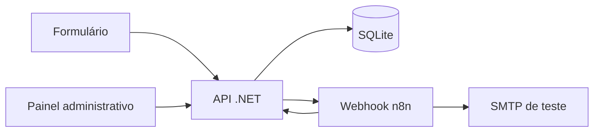
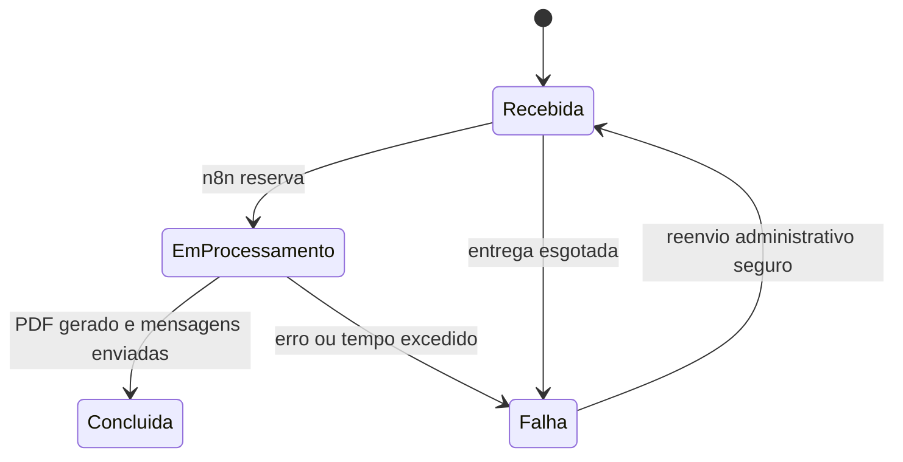

# Arquitetura

A API está dividida em `Endpoints` (HTTP e autenticação), `Services` (validação e PDF), `Models` (contratos e estados) e `Infrastructure` (SQLite e dispatcher). O formulário e o painel são páginas estáticas da mesma origem.

## Estados e histórico

Cada mudança é gravada em `quote_history` na mesma transação que atualiza o pedido. A geração do PDF também é registrada. O reenvio administrativo só é permitido antes da geração do PDF, porque depois disso um e-mail pode ter sido entregue sem confirmação e um novo envio poderia duplicá-lo.

## Entrega e concorrência

O dispatcher reserva pedidos pendentes em transação SQLite, gravando identificador do processo e prazo de dois minutos. Outra instância que compartilhe o banco não consegue reservar o mesmo pedido durante esse prazo. Cada chamada HTTP ao n8n expira em 15 segundos. Se a API parar, a reserva expira e o pedido volta a ficar elegível. A entrega é tentada até cinco vezes, com intervalo de dois minutos. O n8n chama `/iniciar`, que só aceita `Recebida → Em processamento`.

Se um processamento ficar sem atualização por mais de 30 minutos, passa a `Falha`. O SQLite usa WAL. A inicialização adiciona colunas de reserva ao banco anterior e cria serviços, templates e histórico sem apagar pedidos existentes.

Essa coordenação protege a reserva do dispatcher, mas não oferece entrega de e-mail exatamente uma vez. Uma perda de confirmação após aceitação pelo SMTP ainda pode gerar duplicidade; por isso o workflow atualizado desativa repetição automática nos nós de e-mail.

## Segurança e operação

O token interno protege as rotas usadas pelo n8n. A credencial Header Auth protege o webhook do n8n. A área administrativa usa senha definida no ambiente, cookie de sessão e cabeçalho para alterações. Segredos não fazem parte do export do workflow. A chave de idempotência impede cadastro repetido. Os limites de requisição são locais a cada instância.

Para várias instâncias da API, compartilhe o arquivo SQLite em armazenamento adequado e mantenha uma única origem para o painel. Cookies administrativos entre instâncias exigem um chaveiro ASP.NET Data Protection compartilhado; essa configuração não faz parte da demonstração local. Para produção, planeje banco transacional de servidor, HTTPS, gestão de usuários e política de retenção de dados.
